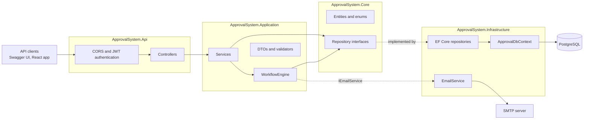
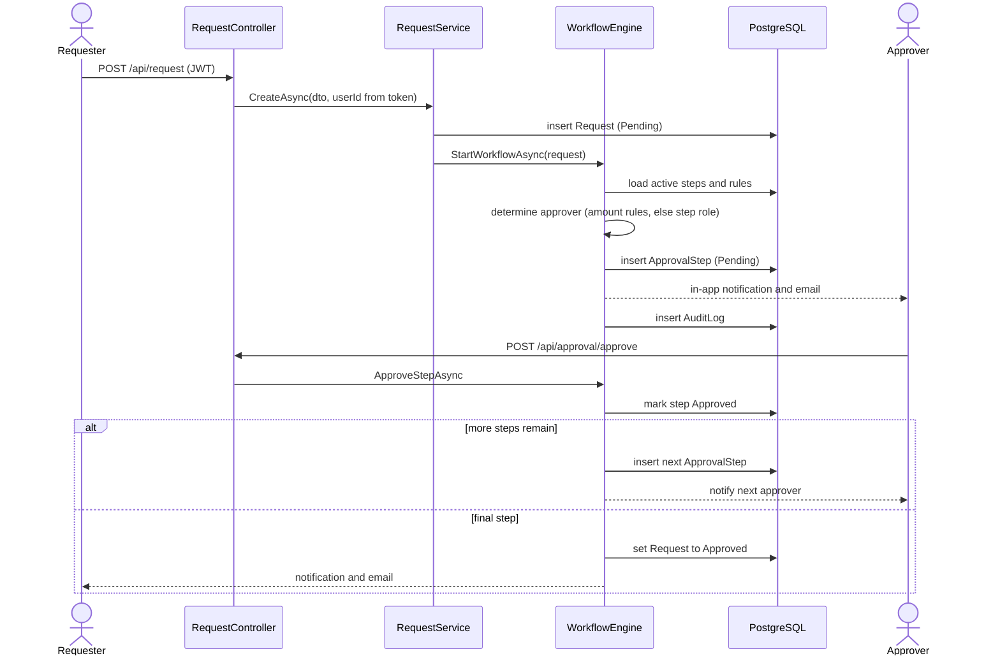
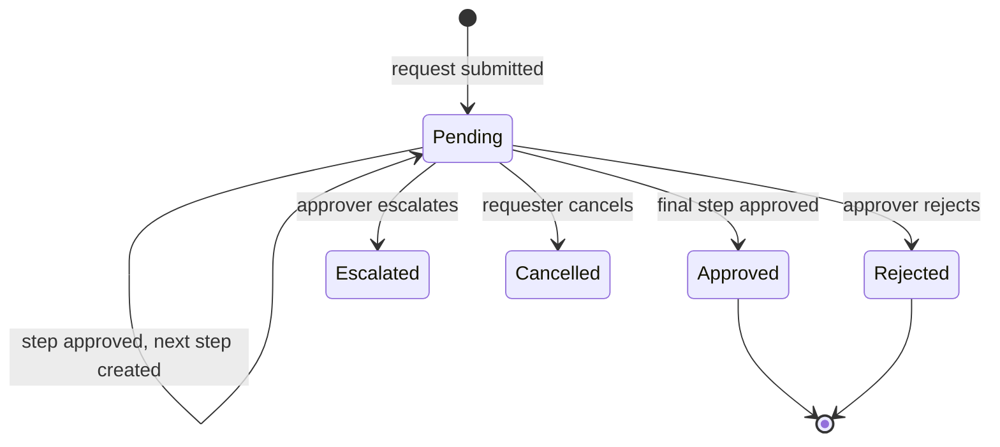
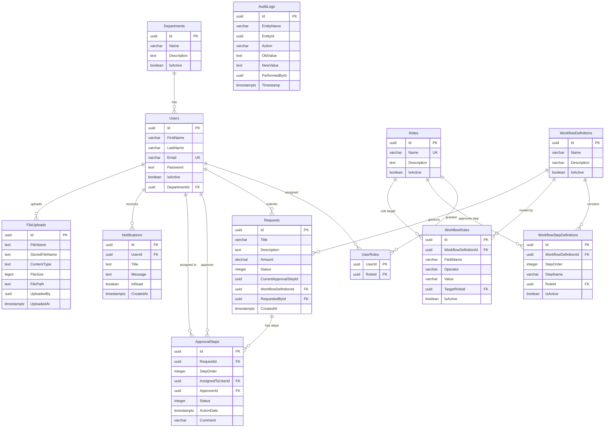

# Approval System

**A configurable, multi-step approval workflow API built with Clean Architecture on ASP.NET Core.**

Employees submit requests (purchases, expenses, any amount-based approval). The system routes each request through an ordered chain of approvers, picks the right approver by role and amount rules, notifies them in-app and by email, and records every action in an audit trail.


> **Demo video:** _add your YouTube link here_

---

## Table of contents

1. [Features](#features)
2. [Tech stack](#tech-stack)
3. [Architecture](#architecture)
4. [How the workflow engine works](#how-the-workflow-engine-works)
5. [Database design](#database-design)
6. [Project structure](#project-structure)
7. [Getting started](#getting-started)
8. [API overview](#api-overview)
9. [Documentation](#documentation)
10. [Roadmap](#roadmap)
11. [Author](#author)

---

## Features

- **Configurable workflows**: define workflow templates made of ordered steps, each mapped to a role.
- **Rule-based routing**: rules on the request `Amount` (`>`, `<`, `>=`, `<=`, `=`) decide which role approves.
- **Approve / reject / escalate** actions with comments, tracked per approval step.
- **Audit trail**: workflow start, approvals, step changes, rejections, escalations and completion are logged.
- **Notifications**: in-app notifications stored in the database, plus email through SMTP (MailKit). Email failures never block the workflow.
- **Users, roles and departments** management, with many-to-many user-to-role assignment.
- **Reports and dashboard**: totals, request trend, requests by status and department, approval time statistics, user activity.
- **JWT authentication** and interactive **Swagger** documentation.
- **Soft-cancel**: deleting a request marks it `Cancelled` instead of removing it.

## Tech stack

| Area | Technology |
|---|---|
| Runtime / framework | .NET 10, ASP.NET Core Web API |
| ORM | Entity Framework Core 10 (code-first migrations) |
| Database | PostgreSQL via Npgsql |
| Authentication | JWT Bearer (HMAC-SHA256) |
| Validation | FluentValidation |
| Email | MailKit (SMTP, STARTTLS) |
| API docs | Swashbuckle (Swagger UI) |
| Architecture | Clean Architecture, Repository pattern, dependency injection |

## Architecture

The solution is split into four projects. Dependencies point inward: the domain (`Core`) knows nothing about frameworks, and the outer layers depend on it.



| Project | Responsibility |
|---|---|
| `ApprovalSystem.Core` | Entities, enums, repository interfaces. No external dependencies. |
| `ApprovalSystem.Application` | Business logic: services, the workflow engine, DTOs, validators, settings classes. Depends on Core only. |
| `ApprovalSystem.Infrastructure` | EF Core `DbContext`, entity configurations, migrations, repositories, SMTP email service. |
| `ApprovalSystem.Api` | Controllers, JWT and CORS setup, Swagger, composition root (`Program.cs`). |

More detail in [docs/ARCHITECTURE.md](docs/ARCHITECTURE.md).

## How the workflow engine works

When a request is submitted, the engine loads the workflow's active steps, picks an approver for the first step, creates an `ApprovalStep`, and notifies the approver. Each approval creates the next step until none remain, at which point the request is `Approved`.



Request status lifecycle:



Full explanation, including approver selection rules: [docs/WORKFLOW_ENGINE.md](docs/WORKFLOW_ENGINE.md).

## Database design

PostgreSQL, 12 tables, managed with EF Core migrations.



Column-level data dictionary, enums, indexes and migration history: [docs/DATABASE.md](docs/DATABASE.md).

## Project structure

```
ApprovalSystem/
├── ApprovalSystem.slnx
├── ApprovalSystem.Api/
│   ├── Controllers/              # REST controllers (one per resource)
│   ├── Program.cs                # DI, JWT, CORS, Swagger
│   ├── appsettings.example.json  # copy to appsettings.json and fill in
│   └── Properties/launchSettings.json
├── ApprovalSystem.Application/
│   ├── Services/                 # business logic + WorkflowEngine
│   ├── Interfaces/               # service contracts
│   ├── DTOs/                     # request/response models by feature
│   ├── Validators/               # FluentValidation rules
│   └── Common/                   # JwtSettings, SmtpSettings
├── ApprovalSystem.Core/
│   ├── Entities/                 # domain entities
│   ├── Enums/                    # RequestStatus, ApprovalStatus
│   └── Interfaces/               # repository contracts
├── ApprovalSystem.Infrastructure/
│   ├── Persistence/              # DbContext, design-time factory, Migrations/
│   ├── Configuration/            # EF entity type configurations
│   ├── Repositories/             # repository implementations
│   └── Services/EmailService.cs  # MailKit SMTP sender
├── docs/                         # detailed documentation
└── promo-video/                  # Remotion project that renders the demo video
```

## Getting started

### Prerequisites

- [.NET 10 SDK](https://dotnet.microsoft.com/download)
- PostgreSQL (local install or Docker)
- `dotnet-ef` tool: `dotnet tool install --global dotnet-ef`
- An SMTP account if you want email notifications (optional; in-app notifications work without it)

### 1. Clone

```bash
git clone https://github.com/collarfil/ApprovalSystem.git
cd ApprovalSystem
```

### 2. Configure

```bash
cp ApprovalSystem.Api/appsettings.example.json ApprovalSystem.Api/appsettings.json
```

Edit `appsettings.json` and set your PostgreSQL connection string, a long random JWT `SecretKey` (at least 32 characters), and your SMTP details. **Never commit this file.** It is listed in `.gitignore`.

Generate a key:

```bash
openssl rand -base64 32
```

### 3. Create the database

Run from the Infrastructure project folder (the design-time factory reads `../ApprovalSystem.Api/appsettings.json`):

```bash
cd ApprovalSystem.Infrastructure
dotnet ef database update --startup-project ../ApprovalSystem.Api
```

### 4. Run

```bash
cd ..
dotnet run --project ApprovalSystem.Api
```

The API listens on `http://localhost:5242` (and `https://localhost:7234` with the https profile). Open Swagger UI at **http://localhost:5242/swagger**.

### 5. Try it

A step-by-step walkthrough (create roles, users, a workflow, submit and approve a request) is in [docs/API.md](docs/API.md#end-to-end-walkthrough).

## API overview

All routes are under `/api`. Full reference with request bodies: [docs/API.md](docs/API.md).

| Resource | Base route | Highlights |
|---|---|---|
| Auth | `/api/auth` | `POST register`, `POST login` (returns JWT) |
| Requests | `/api/request` | create, list, get, update, cancel |
| Approvals | `/api/approval` | `POST approve`, `POST reject`, `POST escalate`, `GET pending/{approverId}` |
| Workflow setup | `/api/workflowsetup`, `/api/workflowdefinition`, `/api/workflowstepdefinition`, `/api/workflowrule` | define templates, steps and routing rules |
| Directory | `/api/user`, `/api/role`, `/api/userrole`, `/api/department` | users, roles, assignments, departments |
| Notifications | `/api/notification` | per-user list, unread, count, mark as read |
| Audit | `/api/auditlog` | read the audit trail |
| Files | `/api/fileupload` | file metadata records |
| Reports | `/api/report`, `/api/dashboard` | dashboard, trend, by status, by department, approval time, user activity |

Authenticate by sending `Authorization: Bearer <token>`.

## Documentation

| Document | What it covers |
|---|---|
| [docs/ARCHITECTURE.md](docs/ARCHITECTURE.md) | Layers, dependency rule, request lifecycle, design decisions |
| [docs/WORKFLOW_ENGINE.md](docs/WORKFLOW_ENGINE.md) | Step processing, approver selection, status transitions |
| [docs/DATABASE.md](docs/DATABASE.md) | ERD, data dictionary, enums, indexes, migrations |
| [docs/API.md](docs/API.md) | Endpoint reference and end-to-end walkthrough |
| [docs/SECURITY.md](docs/SECURITY.md) | Current security posture and hardening checklist |
| [CONTRIBUTING.md](CONTRIBUTING.md) | Branching, commit style, how to add a feature |
| [CHANGELOG.md](CHANGELOG.md) | Notable changes |

## Roadmap

- [ ] Password hashing and role-based authorization policies (see [docs/SECURITY.md](docs/SECURITY.md))
- [ ] Take the approver identity from the JWT instead of the request body
- [ ] Global exception handling with `ProblemDetails` responses
- [ ] Register and enforce FluentValidation validators
- [ ] Real file storage behind the file upload endpoints
- [ ] Unit tests (workflow engine) and integration tests (API + database)
- [ ] Dockerfile and `docker-compose` for API + PostgreSQL
- [ ] CI pipeline (build, test) with GitHub Actions
- [ ] React front end (CORS is already configured for a dev client on ports 5173 and 5177)

## Author

**Collins**, Backend Software Engineer. Clean Architecture and multi-tenant SaaS with ASP.NET Core.

GitHub: [@collarfil](https://github.com/collarfil)

## License

Released under the [MIT License](LICENSE).
