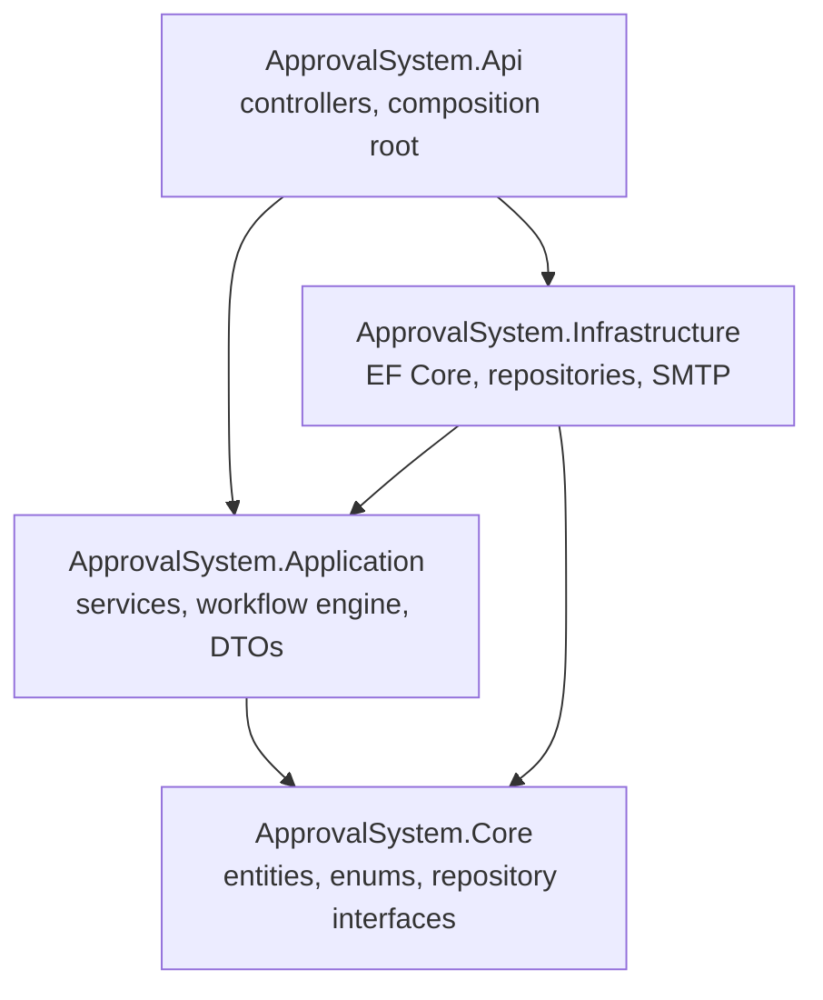

# Architecture

## Goals

- Keep business rules independent from frameworks, the database and the web layer.
- Make the workflow engine easy to test by hiding persistence and email behind interfaces.
- Keep controllers thin: they translate HTTP to service calls.

## Layers and the dependency rule

Project references (from the `.csproj` files):

| Project | References |
|---|---|
| Core | nothing |
| Application | Core |
| Infrastructure | Core, Application |
| Api | Application, Infrastructure |

`Core` defines repository interfaces (`IRequestRepository`, `IApprovalStepRepository`, ...). `Infrastructure` implements them with EF Core. `Application` services depend only on the interfaces, and also on `IEmailService`, which `Infrastructure` implements with MailKit. `Program.cs` wires everything together through dependency injection.

## Layer contents

### Core
- **Entities:** `User`, `Role`, `UserRole`, `Department`, `Request`, `ApprovalStep`, `WorkflowDefinition`, `WorkflowStepDefinition`, `WorkflowRule`, `AuditLog`, `Notification`, `FileUpload`.
- **Enums:** `RequestStatus`, `ApprovalStatus`.
- **Interfaces:** one repository contract per aggregate plus `IGenericRepository`.
- **Models:** `DashboardSummary` read model.

### Application
- **Services:** `AuthService`, `TokenService`, `RequestService`, `ApprovalService`, `WorkflowEngine`, `WorkflowDefinitionService`, `WorkflowStepDefinitionService`, `WorkflowRuleService`, `UserService`, `RoleService`, `UserRoleService`, `DepartmentService`, `NotificationService`, `AuditLogService`, `FileUploadService`, `DashboardService`, `ReportService`.
- **DTOs:** grouped by feature (Auth, Requests, Approvals, Workflows, Reports, ...). Entities are never returned directly from controllers.
- **Validators:** FluentValidation rules for login and request creation.
- **Settings:** `JwtSettings`, `SmtpSettings`, bound from configuration with the options pattern.

### Infrastructure
- **Persistence:** `ApprovalDbContext`, a design-time `ApprovalDbContextFactory` for `dotnet ef`, and the `Migrations/` folder.
- **Configuration:** one `IEntityTypeConfiguration<T>` per entity (lengths, keys, unique indexes, relationships), loaded with `ApplyConfigurationsFromAssembly`.
- **Repositories:** EF Core implementations, including the eager-loading queries the engine needs (`GetWithStepsAsync`, `GetCurrentStepAsync`, `GetPendingApprovalsAsync`).
- **Email:** `EmailService` using MailKit with STARTTLS.

### Api
- 17 controllers, JWT bearer authentication, a `ReactPolicy` CORS policy for `http://localhost:5173` and `http://localhost:5177`, and Swagger with a Bearer security definition.

## Request lifecycle

1. The client calls an endpoint with `Authorization: Bearer <jwt>`.
2. ASP.NET Core middleware order: routing, CORS, authentication, authorization, then the controller.
3. The controller maps the body to a DTO and calls a service interface.
4. The service applies business rules, using repository interfaces for data and `IEmailService` for mail.
5. Repositories use `ApprovalDbContext` (Npgsql) to read and write PostgreSQL.
6. The service returns a DTO, and the controller returns an HTTP result.

## Design decisions

| Decision | Reason |
|---|---|
| Workflow as data (definitions, steps, rules in tables) | Approval chains can change without redeploying code. |
| Separate `WorkflowStepDefinition` (template) and `ApprovalStep` (runtime instance) | A template can be edited without rewriting history of past requests. |
| Rules on `Amount` pick a target role | Simple, understandable routing that covers the common "bigger amount, senior approver" case. |
| Email is best-effort | A mail outage should not block an approval; the in-app notification is always saved. |
| Soft cancel for requests | Keeps the record and its audit trail. |
| GUID primary keys | IDs can be generated in the application layer before insert. |
| Repository pattern over a generic `DbContext` in services | Services stay testable and persistence-agnostic. |

## Configuration

| Section | Keys | Used by |
|---|---|---|
| `ConnectionStrings` | `DefaultConnection` | `ApprovalDbContext` (Npgsql) |
| `JwtSettings` | `SecretKey`, `Issuer`, `Audience`, `ExpiryMinutes` | `TokenService`, JWT middleware |
| `SMTP` | `Host`, `Port`, `Username`, `Password`, `FromEmail`, `FromName`, `EnableSsl` | `EmailService` |

See `ApprovalSystem.Api/appsettings.example.json`.

## Extending the system

- **New resource:** add an entity in Core, a repository interface in Core, an EF configuration and repository in Infrastructure, a service interface and implementation plus DTOs in Application, a controller in Api, then register the services in `Program.cs`, and add a migration.
- **New rule field or operator:** extend `DetermineApproverAsync` in `WorkflowEngine` (currently only the `Amount` field is evaluated).
