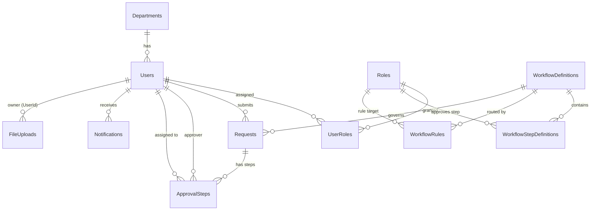
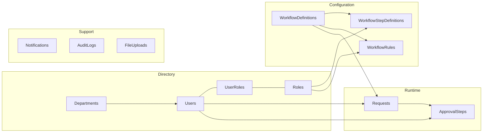

# Database

- **Engine:** PostgreSQL (EF Core provider `Npgsql.EntityFrameworkCore.PostgreSQL`)
- **Approach:** code-first with EF Core migrations
- **Tables:** 12
- **Keys:** `uuid` primary keys generated in the application layer

## Entity relationship diagram



Two relationships are logical only, with no foreign key constraint: `AuditLogs.PerformedById` and `AuditLogs.EntityId` point at users and entities by id, and `Requests.CurrentApprovalStepId` points at an `ApprovalSteps` row.

## Domain overview



## Data dictionary

PK = primary key, FK = foreign key, UQ = unique, NN = not null. All foreign keys currently use `ON DELETE CASCADE`.

### Departments
| Column | Type | Constraints |
|---|---|---|
| Id | uuid | PK |
| Name | varchar(100) | NN |
| Description | text | NN |
| IsActive | boolean | NN |

### Users
| Column | Type | Constraints |
|---|---|---|
| Id | uuid | PK |
| FirstName | varchar(100) | NN |
| LastName | varchar(100) | NN |
| Email | varchar(200) | NN, UQ |
| Password | text | NN |
| IsActive | boolean | NN |
| DepartmentId | uuid | FK to Departments, NN, indexed |

### Roles
| Column | Type | Constraints |
|---|---|---|
| Id | uuid | PK |
| Name | varchar(100) | NN, UQ |
| Description | text | NN |
| IsActive | boolean | NN |

### UserRoles (join table)
| Column | Type | Constraints |
|---|---|---|
| UserId | uuid | PK (composite), FK to Users |
| RoleId | uuid | PK (composite), FK to Roles, indexed |

### WorkflowDefinitions
| Column | Type | Constraints |
|---|---|---|
| Id | uuid | PK |
| Name | varchar(150) | NN |
| Description | varchar(500) | |
| IsActive | boolean | NN |

### WorkflowStepDefinitions
| Column | Type | Constraints |
|---|---|---|
| Id | uuid | PK |
| WorkflowDefinitionId | uuid | FK to WorkflowDefinitions, indexed |
| StepOrder | integer | NN |
| StepName | varchar(100) | NN |
| RoleId | uuid | FK to Roles, indexed |
| IsActive | boolean | NN |

### WorkflowRules
| Column | Type | Constraints |
|---|---|---|
| Id | uuid | PK |
| WorkflowDefinitionId | uuid | FK to WorkflowDefinitions, indexed |
| FieldName | varchar(100) | NN (for example `Amount`) |
| Operator | varchar(20) | NN (`>`, `<`, `>=`, `<=`, `=`) |
| Value | varchar(100) | NN |
| TargetRoleId | uuid | FK to Roles, indexed |
| IsActive | boolean | NN |

### Requests
| Column | Type | Constraints |
|---|---|---|
| Id | uuid | PK |
| Title | varchar(200) | NN |
| Description | text | NN |
| Amount | numeric(18,2) | NN |
| Status | integer | NN, see `RequestStatus` |
| CurrentApprovalStepId | uuid | nullable, no FK constraint |
| WorkflowDefinitionId | uuid | FK to WorkflowDefinitions, indexed |
| RequestedById | uuid | FK to Users, indexed |
| CreatedAt | timestamptz | NN |

### ApprovalSteps
| Column | Type | Constraints |
|---|---|---|
| Id | uuid | PK |
| RequestId | uuid | FK to Requests, indexed |
| StepOrder | integer | NN |
| AssignedToUserId | uuid | FK to Users, indexed |
| ApproverId | uuid | FK to Users, indexed |
| Status | integer | NN, see `ApprovalStatus` |
| ActionDate | timestamptz | nullable |
| Comment | varchar(500) | nullable |

### AuditLogs
| Column | Type | Constraints |
|---|---|---|
| Id | uuid | PK |
| EntityName | varchar(100) | NN |
| EntityId | uuid | NN, no FK |
| Action | varchar(100) | NN |
| OldValue | text | |
| NewValue | text | |
| PerformedById | uuid | NN, no FK |
| Timestamp | timestamptz | NN |

### Notifications
| Column | Type | Constraints |
|---|---|---|
| Id | uuid | PK |
| UserId | uuid | FK to Users, indexed |
| Title | text | NN |
| Message | text | NN |
| IsRead | boolean | NN |
| CreatedAt | timestamptz | NN |

### FileUploads
| Column | Type | Constraints |
|---|---|---|
| Id | uuid | PK |
| FileName | text | NN |
| StoredFileName | text | NN |
| ContentType | text | NN |
| FileSize | bigint | NN |
| FilePath | text | NN |
| UploadedBy | uuid | NN, plain column |
| UploadedAt | timestamptz | NN |
| UserId | uuid | FK to Users, indexed (EF shadow foreign key) |

> **Note:** `FileUpload` has a `User` navigation property without a matching foreign key property, so EF Core created a shadow `UserId` column in addition to `UploadedBy`. `FileUploadService` fills `UploadedBy` only. See [SECURITY.md](SECURITY.md#correctness-issues-found-during-review) for the recommended fix.

## Enums (stored as integers)

| `RequestStatus` | Value |
|---|---|
| Draft | 1 |
| Pending | 2 |
| InProgress | 3 |
| Approved | 4 |
| Rejected | 5 |
| Escalated | 6 |
| Cancelled | 7 |

| `ApprovalStatus` | Value |
|---|---|
| Pending | 1 |
| Approved | 2 |
| Rejected | 3 |
| Escalated | 4 |
| Skipped | 5 |
| Waiting | 6 |

## Unmapped classes

`Comment` and `AuditHistory` exist in `ApprovalSystem.Core/Entities` but have no `DbSet` and no table. They are placeholders for future features (request comments, per-user history).

## Migrations

Located in `ApprovalSystem.Infrastructure/Persistence/Migrations/`.

| Migration | Purpose |
|---|---|
| `20260618105608_InitialCreate` | Core tables |
| `20260625123300_AddNotificationAndFileUpload` | Notifications and file upload records |
| `20260630170617_AddIsActiveToWorkflowStepDefinition` | `IsActive` on workflow steps |
| `20260707075942_AddCurrentApprovalStepId` | `Requests.CurrentApprovalStepId` |
| `20260929115951_InitialApprovalMigration` | Consolidated schema migration |

Common commands (run from `ApprovalSystem.Infrastructure`):

```bash
# apply all migrations
dotnet ef database update --startup-project ../ApprovalSystem.Api

# add a migration
dotnet ef migrations add <Name> --startup-project ../ApprovalSystem.Api

# remove the last migration (if not applied)
dotnet ef migrations remove --startup-project ../ApprovalSystem.Api

# generate an SQL script
dotnet ef migrations script --startup-project ../ApprovalSystem.Api -o schema.sql
```

## Suggested improvements

- Add an index on `Requests.Status` and `ApprovalSteps(Status, ApproverId)` for dashboard and pending-approval queries.
- Change cascading deletes to `Restrict` for `Users` and `Roles`, and prefer soft delete (`IsActive`) to protect history.
- Add foreign keys (or at least indexes) for `AuditLogs.PerformedById` and `Requests.CurrentApprovalStepId`.
- Use a `xmin` or row-version concurrency token on `ApprovalSteps`.
