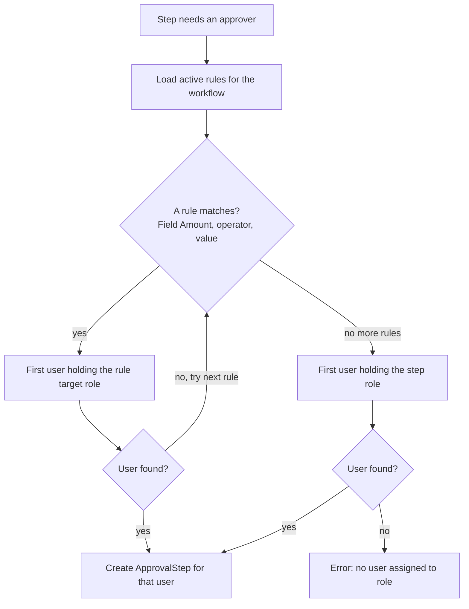

# Workflow engine

The engine lives in `ApprovalSystem.Application/Services/WorkflowEngine.cs` (`IWorkflowEngine`). It is called by `RequestService` when a request is created and by `ApprovalService` / `WorkflowController` when an approver acts.

## Concepts

| Concept | Entity | Purpose |
|---|---|---|
| Workflow template | `WorkflowDefinition` | A named, activatable approval process |
| Step template | `WorkflowStepDefinition` | Ordered step (`StepOrder`) assigned to a `Role` |
| Routing rule | `WorkflowRule` | Condition on a request field that redirects approval to a target role |
| Runtime step | `ApprovalStep` | One approval task for one request, assigned to one user |
| Request | `Request` | The thing being approved (title, description, amount) |

## Starting a workflow

`StartWorkflowAsync(request)`:

1. Loads the workflow definition. Fails if it does not exist or `IsActive` is false.
2. Loads the active steps, ordered by `StepOrder`. Fails if there are none.
3. Picks an approver for the first step (see below).
4. Creates an `ApprovalStep` with status `Pending` and stores its id in `Request.CurrentApprovalStepId`.
5. Sets the request status to `Pending`.
6. Creates an in-app notification for the approver and tries to send an email.
7. Writes an audit log entry (`Workflow Started`).

## Choosing the approver

Rule evaluation details:

- Only `FieldName = "Amount"` (case-insensitive) is evaluated today.
- Supported operators: `>`, `<`, `>=`, `<=`, `=`. `Value` is parsed as a decimal.
- Rules are checked in stored order and the first match with an available user wins.
- "First user holding the role" means the first row returned by `IUserRoleRepository.GetByRoleIdAsync`.

Example: a workflow has steps `1 Manager` and `2 Finance`, and a rule `Amount > 1000000 -> Director`. A request of 250,000 matches no rule, so step 1 goes to a Manager and step 2 to a Finance user. A request of 2,500,000 matches the rule, so the engine assigns the Director for each step it creates, because rules are evaluated for the whole workflow rather than per step.

## Actions

| Action | Method | Effect |
|---|---|---|
| Approve | `ApproveStepAsync` | Marks the current `Pending` step `Approved` (with comment and `ActionDate`), writes an audit entry, then moves to the next step. |
| Reject | `RejectStepAsync` | Marks the step `Rejected`, sets the request to `Rejected`, clears `CurrentApprovalStepId`, notifies the requester, writes an audit entry. |
| Escalate | `EscalateStepAsync` | Sets the request to `Escalated`, writes an audit entry, notifies the requester. |

Approve and reject require the supplied `approverId` to equal the current step's `ApproverId`; otherwise `Unauthorized approver` is thrown.

### Moving to the next step

After an approval, the engine finds the first active step whose `StepOrder` is greater than the one just completed. If there is one, it picks an approver, creates the next `ApprovalStep`, notifies that approver and writes an audit entry. If not, `CompleteWorkflowAsync` sets the request to `Approved`, clears `CurrentApprovalStepId`, notifies the requester and logs `Workflow Completed`.

## Status values

`RequestStatus`: `Draft (1)`, `Pending (2)`, `InProgress (3)`, `Approved (4)`, `Rejected (5)`, `Escalated (6)`, `Cancelled (7)`.

`ApprovalStatus`: `Pending (1)`, `Approved (2)`, `Rejected (3)`, `Escalated (4)`, `Skipped (5)`, `Waiting (6)`.

The engine currently uses `Pending`, `Approved`, `Rejected`, `Escalated` and `Cancelled` on requests, and `Pending`, `Approved`, `Rejected` on steps. The other values are reserved for future behaviour (drafts, skipped or parallel steps).

## Notifications and email

- Every notification is first saved to the `Notifications` table through `INotificationService`.
- Emails (`SendApprovalAssignedAsync`, `SendRequestApprovedAsync`, `SendRequestRejectedAsync`) are wrapped in try/catch. A failure is logged to the console and does not stop the workflow.

## Audit events

`Workflow Started`, `Approval`, `Moved To Next Step`, `Workflow Completed`, `Rejected`, `Escalated`. Each is stored in `AuditLogs` with entity name, entity id, action, new value (the comment), and the user who acted.

## Known limitations

- Escalation does not reassign the request or validate the caller.
- Rules are evaluated for the whole workflow, not per step.
- Only the `Amount` field is supported in rules.
- Steps are sequential; there is no parallel or "any of N approvers" mode.
- There is no concurrency token: two simultaneous actions on the same step are not guarded.
